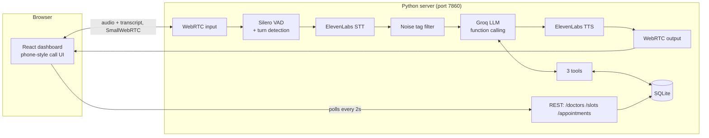

# City Care: Voice AI Doctor Appointment Assistant

A voice agent that books, checks and cancels doctor appointments over a live call.
The caller is identified only by the phone number they say out loud. A web dashboard
lets you place the call, read the live transcript, and watch doctors, slots and
appointments update as the agent works.

**LLM used:** Groq, `openai/gpt-oss-120b` (OpenAI-compatible API).
Gemini is also supported (`LLM_PROVIDER=gemini`). See [Design decisions](#design-decisions).

**Demo video:** EDIT: paste l
**Author:SAGARAPU MANOJ** 
---
## What it does

- Talk to the agent from the browser. It greets you, then handles three actions in one conversation:
  - `check_doctor_availability`: lists open slots by doctor and/or date
  - `book_appointment`: books a slot for the caller's phone number
  - `cancel_appointment`: cancels the caller's existing appointment
- The agent reads the phone number back digit by digit and waits for a "yes" before any booking or cancellation. This is enforced in code, not just in the prompt.
- The dashboard shows a live transcript, doctors, slots and appointments. Rows highlight and a confirmation card appears when the agent books or cancels.

## Architecture



**Pipeline in order:** caller audio, SmallWebRTC transport, Silero VAD, ElevenLabs STT,
noise filter, LLM (with tools), ElevenLabs TTS, transport output back to the browser.

## Tech stack

| Part | Choice |
|---|---|
| Voice framework | Pipecat 1.17.0 (Python) |
| Transport | SmallWebRTC (no extra account needed) |
| VAD | Silero VAD |
| STT / TTS | ElevenLabs |
| LLM | Groq `openai/gpt-oss-120b` (Gemini optional) |
| Data | SQLite (mock doctors and slots) |
| API | FastAPI (the same app Pipecat's runner uses) |
| Frontend | React + Vite, plain CSS |

## Project structure

```
voice-doctor-assistant/
├── backend/
│   ├── bot.py          # Pipecat pipeline, system prompt, entry point
│   ├── tools.py        # 3 tools: logic, schemas, handlers
│   ├── db.py           # SQLite layer, atomic booking, phone normalization
│   ├── seed.py         # mock doctors and slots (relative to today)
│   ├── server.py       # REST routes for the dashboard
│   ├── tests/          # pytest suite for the tools
│   └── requirements.txt
├── frontend/           # React dashboard
├── .env.example
└── README.md
```

## Setup

### Prerequisites

- Python 3.11 or newer, Node.js 20 or newer
- An [ElevenLabs](https://elevenlabs.io) API key and a **premade** voice ID
  (library voices need a paid plan through the API)
- A [Groq](https://console.groq.com) API key (free tier), or a Google AI Studio key for Gemini

### 1. Environment variables

Copy `.env.example` to `.env` in the project root and fill it in:

```
ELEVENLABS_API_KEY=
ELEVENLABS_VOICE_ID=
LLM_PROVIDER=groq
GROQ_API_KEY=
GROQ_MODEL=openai/gpt-oss-120b
GOOGLE_API_KEY=
GEMINI_MODEL=gemini-3.8-flash
```

Never commit `.env`. It is in `.gitignore`.

### 2. Backend (Windows PowerShell)

```powershell
cd backend
python -m venv venv
.\venv\Scripts\Activate.ps1
pip install -r requirements.txt
python seed.py --reset
python bot.py
```

On macOS or Linux, activate with `source venv/bin/activate`.

The server runs on `http://localhost:7860`. Pipecat's built-in test page is at
`http://localhost:7860/client`. REST routes are at `/doctors`, `/slots`, `/appointments`.

### 3. Frontend

```powershell
cd frontend
npm install
npm run dev
```

Open `http://localhost:5173`. Click the green call button, allow the microphone, and wait for the greeting.
Use a headset in a quiet room. Speakers feed the agent's voice back into the mic.

### 4. Tests

```powershell
cd backend
python -m pytest -v
```

The tests run against a temporary database and need no API keys.

## Try it

1. "What doctors are available tomorrow?"
2. Pick a doctor and time, then say your name.
3. Say a 10-digit phone number. The agent reads it back digit by digit. Say "yes".
4. The appointment appears on the dashboard, and a confirmation card shows in the phone.
5. Say "cancel my appointment", then confirm the number again.

Run `python seed.py --reset` before a demo to clear old bookings.

## Design decisions

**Phone-number confirmation is enforced in code.** `book_appointment` and
`cancel_appointment` take a required `number_confirmed_by_caller` boolean. If it is not
`true`, the tool returns `number_not_confirmed` and writes nothing. The prompt tells the
model when to set it, and the code guarantees that a skipped read-back cannot cause a booking.
This matters because speech-to-text often mishears digits and the number is the caller's only identity.

**No double booking.** Booking uses a single atomic statement,
`UPDATE slots SET is_booked = 1 WHERE id = ? AND is_booked = 0`, and checks the row count.
The slot update and the appointment insert happen in one transaction.

**One active appointment per phone number.** This keeps "cancel my appointment"
unambiguous. Different spellings of the same number (`+91 98765 43210`, `098765-43210`,
`9876543210`) are normalized to 10 digits before any lookup.

**Errors are data, not exceptions.** Tools return results like
`{"success": false, "reason": "slot_taken"}`, and the LLM turns them into natural speech.

**Plain functions plus thin handlers.** The tool logic is ordinary Python, so it is tested
without any voice or API keys. The Pipecat handlers only adapt arguments and call `result_callback`.

**SQLite.** Zero setup, a single file, and enough for mock data and atomic updates.

**Noise handling.** ElevenLabs STT sometimes returns tags such as `[background noise]` or
`[laughs]`. A small filter processor drops them before they reach the LLM, which saves
tokens and stops phantom turns. VAD thresholds are raised to ignore short clicks and coughs.

**Dashboard updates by polling.** The frontend polls the REST routes every 2 seconds and
detects new or changed appointments to highlight rows and show the confirmation card.
It is simple and reliable. Server push (SSE or RTVI messages) would be the next step.

**Why Groq.** I started with Gemini, but the free tier allows only about 20 requests per day
per model, which ran out quickly while testing a real-time voice loop. Groq's free tier is fast
and OpenAI-compatible, so it is a small swap. Both providers are supported through `LLM_PROVIDER`.

## Limitations and what I would change for production

- **Identity is only a spoken number.** Add OTP or caller-ID verification, and rate-limit attempts.
- **Real telephony.** Swap SmallWebRTC for Twilio or another SIP provider.
- **Real calendar.** Replace mock SQLite data with the clinic's scheduling system and handle time zones (times are stored as clinic-local strings).
- **Latency and cost.** Free-tier LLM and TTS quotas limit long testing. Production would use paid tiers and streaming throughout.
- **Polling** would become server-sent events.
- **Observability.** Add structured logging of tool calls and per-call analytics.

## Troubleshooting

| Symptom | Likely cause |
|---|---|
| Bot connects but never speaks | ElevenLabs voice not usable on your plan: use a premade voice. Or an LLM `429`: check the terminal. |
| `429` from the LLM | Free quota used up. Wait, or change `GROQ_MODEL`. |
| Transcript shows odd text | Background audio. Use a headset and close other audio tabs. |
| Dashboard says "Server offline" | `python bot.py` is not running on port 7860. |
| Windows console encoding error | Already handled at the top of `bot.py`. |

## Notes

AI tools were used while building this project. Every part is explained above,
and the code is commented where the reasoning is not obvious.